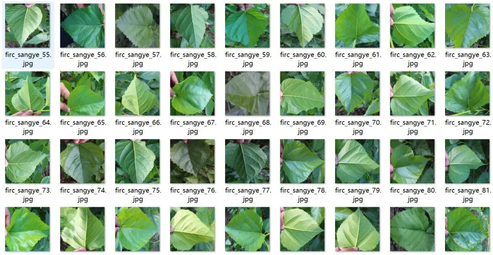
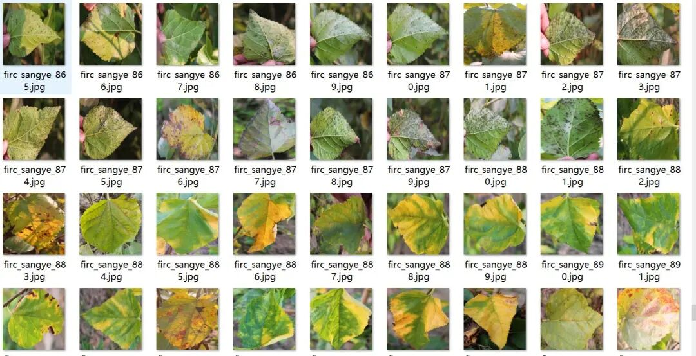
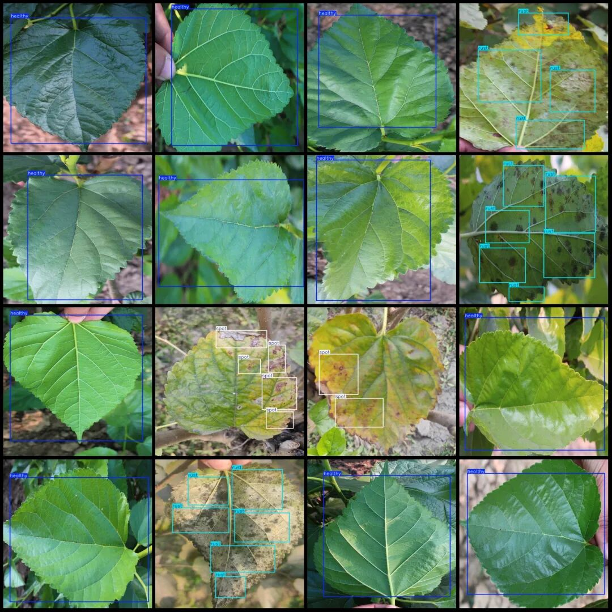
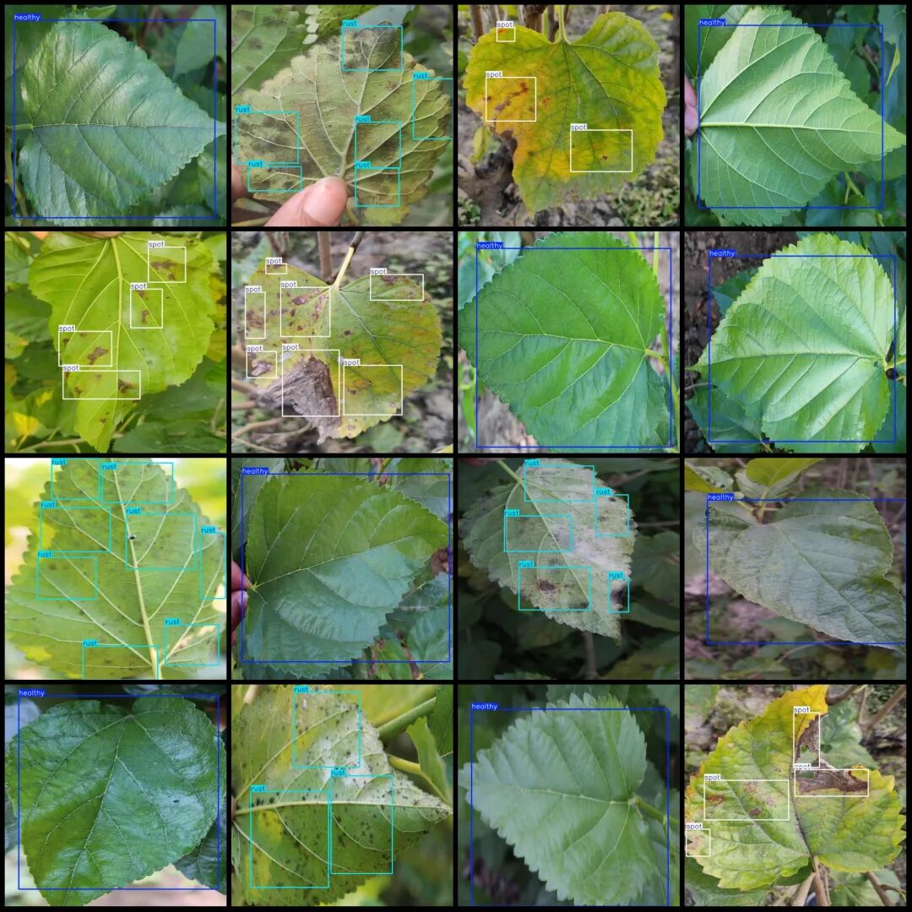

# Sansevieria Disease Detection Dataset VOC+YOLO format with 1043 images in 3 categories

Dataset format: Pascal VOC format + YOLO format (txt file without split path, only containing jpg images and corresponding VOC format xml files and yolo format txt files)

Number of images (number of jpg files): 1043

Number of annotations (number of xml files): 1043

Number of annotations (number of txt files): 1043

Label category count: 3

Label category names (Note that the order of yolo format categories does not correspond to this, but is based on the classes.txt in the labels folder): ["healthy", "rust", "spot"]

Number of boxes labeled in each category:

Healthy (health) frame count = 423

Rust (leaf rust) frame count = 2370

Spot (spotted) frame count = 647

Total frame count: 3440

Number of images per category:

Healthy (health) occupies a picture count = 423

Rust (Phylloxera) occupies 458 images.

Spot (spotted leaf) occupying the image count = 162

Image resolution: 640x640

Using labelImg:

Annotation rules: Draw a rectangle around the category.

Important Notice: The dataset does not have separate training, validation, and test sets; you need to partition them yourself.

Special : This dataset does not guarantee the accuracy of the trained models or weight files.

Image Preview:

Annotation example:

## Payment

Here is a pay link on Stripe ( https://buy.stripe.com/3cs8yP7sY87d0vu9AB ). Please contact me lonlonago@foxmail.com after funding $89, and I will send you a complete data files , thank you!

